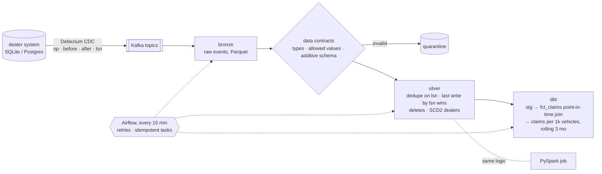

# warranty-lakehouse

**A change-data-capture lakehouse for dealer warranty data: Debezium-style events land in bronze Parquet, are checked against data contracts, and are merged into silver tables (DuckDB, or Spark at scale). dbt then builds tested marts, and Airflow runs it all.** It stays exactly right under duplicates, out-of-order delivery, replays, deletes and schema changes, and it proves that with a row-by-row comparison against the source system.


> The source system is **simulated**: an SQLite dealer-management database with 40 dealers, 3,000 vehicles and 6,000 claims going through submitted → approved → paid, plus adjustments, voids (deletes) and dealer region changes. Every change is emitted as a CDC event, then delivered the way Kafka really delivers: about 3% duplicates and local reordering.

## Results

From `lakehouse run` ([`reports/report.json`](reports/report.json)) and `dbt build`.

| Check | Result |
|---|---|
| Events delivered / unique after dedupe | 12,319 / 11,951 (368 duplicates) |
| **Silver vs. source system, row by row** (claims, vehicles, current dealer version) | **0 missing, 0 unexpected** |
| After a consumer crash **replays 30% of the topic** | LSN pipeline: still exact · naive consumer: **237 stale claims, 29 deleted claims back from the dead** |
| Corrupted events (amount sent as `"1,464.90"`, unknown status) | 40 of 40 quarantined (16 wrong type, 24 unknown status); none reached silver |
| Schema change mid-stream (`labor_hours` added) | Accepted as backward-compatible (contract v2); older rows read as NULL |
| Spark vs. DuckDB silver tables | Identical (parity test in CI) |
| Legacy export reconciliation (7 months: row counts, totals, checksums) | All months match |
| dbt build | 5 models, 11 data tests, all passing |
| Throughput, bronze + silver on one laptop core | about 31,000 events/s (12K events in 0.4 s; 123K events in 1.4 s at 10x scale) |

**Why the naive consumer matters:** applying events in arrival order looks fine on a good day (1 stale claim out of 5,806). The first time a consumer restarts from an old offset, it silently rolls 237 claims back to old statuses and amounts and brings voided claims back. Using the source's log sequence number (LSN) for ordering turns that incident into a non-event.

## Architecture



| Concept | Where |
|---|---|
| CDC (Debezium envelope: `op`, `before`, `after`, `source.lsn`) | `source.py`, `kafka.py` |
| Bronze / silver / gold (medallion) | `pipeline.py`, `dbt/models/` |
| Dedupe and ordering with window functions (`QUALIFY row_number() OVER ...`) | `pipeline.py` |
| SCD Type 2 (contiguous validity intervals, one current row) | `dealers_history` in `pipeline.py`, tested |
| Point-in-time join (dealer region *as of* the claim date) | `dbt/models/marts/fct_claims.sql` |
| Data contracts and quarantine | `contracts/*.yaml`, `pipeline.check` |
| Batch vs. streaming | Micro-batches every 15 minutes: idempotent, replayable and cheap. The same code would run inside a streaming consumer |
| Spark | `spark_silver.py` with a parity test against DuckDB |
| Data migration | `migration.py`: legacy CSV vs. lakehouse, per-month counts, totals and order-independent checksums |
| Orchestration | `dags/warranty_lakehouse.py` (TaskFlow, retries with exponential backoff, `max_active_runs=1`) |

## Quickstart

```bash
git clone https://github.com/rakeshsaineni/warranty-lakehouse && cd warranty-lakehouse
python -m venv .venv && source .venv/bin/activate
make install     # Java 17 is needed for the Spark parity test
make test
make all         # simulate -> bronze -> silver -> verify -> dbt build
duckdb data/warehouse.duckdb "select * from agg_claims_monthly order by claims_per_1k desc limit 5"
```

## Design decisions

- **Order by LSN, never by arrival.** Kafka only guarantees order within a partition, and consumers replay after failures. The source's log position is the one ordering that can't lie.
- **Rebuild silver from bronze instead of mutating it.** At this size, a full deterministic rebuild (0.4 s) is simpler and safer than incremental MERGEs: a bug fix plus a re-run repairs history. At larger scale the same `QUALIFY` logic becomes an incremental `MERGE` keyed on LSN.
- **Contracts at the door.** A string amount that slips into silver breaks every downstream sum quietly. Quarantining it at bronze keeps the rest of the batch moving and leaves a precise error message for the source team.
- **Prove correctness against the source.** Row counts can match while values are wrong. The gate compares full rows, and CI fails on any difference.

## Limitations and next steps

- In the DAG, the bronze reader is a real `confluent-kafka` consumer, but local runs and CI use the simulator. A docker-compose stack (Postgres + Debezium + Kafka) would exercise the full path.
- Swap Parquet folders for Iceberg or Delta tables to get time travel and concurrent writers.
- Add freshness SLAs and volume anomaly checks (dbt source freshness, row-count deltas).

## Project layout

```
src/lakehouse/  source (simulated OLTP + CDC) · pipeline (bronze/contracts/silver) · spark_silver · migration · kafka · report · cli
contracts/      YAML data contracts       dbt/  staging + marts + tests       dags/  Airflow DAG
```
